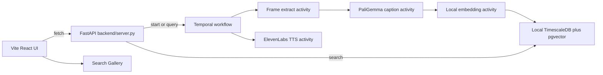

# Smart Proxy Tagger — Architecture

Smart Proxy Tagger is a localhost tool for videographers. It watches a folder of raw footage, describes sampled frames with a local open-weight vision model, and lets the editor search those descriptions by plain language. A query such as "drone over water at sunset" returns the file path and the timestamp.

The person who would pay is a freelance editor or a small production company. Their raw cards are large, the footage belongs to a client, and a per-minute cloud vision API makes the bill grow with the shoot. The open model runs on the machine that already holds the files. Closing the app does not throw away a job that is already in progress.

This document is the contract for the code that follows. Phases 2–4 implement it. They do not invent a second design.

## System



Everything except the ElevenLabs voice call stays on the machine. ElevenLabs receives one short sentence when a job finishes ("Your footage is indexed"), never a frame and never a file path that identifies a client.

| Piece | Where it runs | Default address |
| --- | --- | --- |
| Vite + React UI | This machine | `http://127.0.0.1:5173` |
| FastAPI | This machine | `http://127.0.0.1:8000` |
| Temporal dev server and worker | This machine | `localhost:7233` |
| TimescaleDB with pgvector | Docker on this machine | `127.0.0.1:15432` |
| PaliGemma and the embedding model | Process memory on this machine | no network service |
| ElevenLabs text-to-speech | Their API, key in `.env` | HTTPS from the worker |

## How the UI talks to the API

The frontend is a Vite app in `/frontend`, written in React and TypeScript and styled with Tailwind. It has three surfaces:

1. **Dropzone.** The editor picks a local file or folder. The browser cannot read an arbitrary disk path by itself, so the UI sends the path the user selected (or a path they paste) to the API. The API checks that the path exists on this machine and is a video file or a directory of video files.
2. **Processing dashboard.** After `POST /api/jobs`, the UI polls `GET /api/jobs/{id}` about once a second and draws a progress bar from the workflow query. The bar shows frames seen, frames captioned, and whether the voice notification has played.
3. **Search gallery.** `GET /api/search?q=` returns hits. Each hit shows the video path, the timestamp, the caption, and which signal matched (vector, keyword, or both). A vector neighbor whose cosine distance is 0.85 or more is dropped before fusion, so a query with no overlap does not list every stored moment.

The client uses `fetch` against `http://127.0.0.1:8000`. FastAPI allows that origin. There is no account system in the hackathon build: the tool is one person, one laptop.

## What a job does

`POST /api/jobs` does not process video inside the request. It starts a Temporal workflow and returns the workflow id. The HTTP call returns immediately so the UI stays responsive.

The workflow is one durable execution with a small number of activities:

1. **Discover.** List video files under the path. Record the list in workflow state.
2. **Extract.** Pull a sparse set of frames with ffmpeg or OpenCV. The demo samples about one frame every few seconds. A full-rate extract is the wrong default for a laptop and for a judging demo.
3. **Caption and store.** This is one long-running activity, not one activity per frame. It loads PaliGemma, describes each pending frame, embeds the caption, and upserts the row. After each frame it heartbeats a cursor: file path plus frame index. If the worker dies, Temporal retries the activity and the activity reads the last heartbeat and continues from that frame.
4. **Notify.** Call ElevenLabs for a one-sentence completion clip, save the audio under a local temp path, and play it. A failure here is retried on its own. It does not re-caption the video.

Heartbeats matter because a long shoot can mean thousands of frames. Recording a separate Temporal event for every frame fills the workflow history. One activity that heartbeats a cursor keeps the history small and still resumes after a crash. That pattern is what DEV builders report for multi-hour Temporal jobs (see [What DEV builders reported](#what-dev-builders-reported)).

Closing the React app stops the polls. It does not stop the worker. Reopening the dashboard and asking for the same workflow id shows the current cursor.

## PaliGemma

PaliGemma is Google's open vision-language model in the Gemma family. It looks at a frame and returns a short text caption. Those captions are the tags the editor searches.

PaliGemma does not emit the search vector. A second, small local embedding model (sentence-transformers `all-MiniLM-L6-v2`, 384 dimensions) turns the caption into a vector. The same model embeds the search query, so the spaces match.

The caption model loads through Hugging Face Transformers on this machine, because PaliGemma is a vision-language checkpoint and that is the path that accepts its image processor. A llama.cpp build is a fallback only when a vision-capable GGUF of this checkpoint actually loads. Frames are never sent to a hosted vision API.

Local Gemma measurements on DEV are for text models, and they set the budget for this laptop. A quantized Gemma-family model is what fits. On an 8 GB GPU, a 4-bit text Gemma in the 2B class leaves room for context; the 4B class costs about half the speed for a modest quality gain; CPU-only generation on a laptop is several times slower than a small GPU. PaliGemma's cost is an image encode plus a short caption, which is a different shape than a long chat, so those token rates are a budget warning and not a promise. The worker keeps a single model resident and captions one frame at a time. The demo clip stays short.

## Local Tiger Data and pgvector

The database is TimescaleDB running in Docker on localhost, with the pgvector extension. TimescaleDB is Tiger Data's Postgres engine. The connection string points at `127.0.0.1` only. The app refuses a host that is not loopback.

One table holds the searchable moments:

| Column | Role |
| --- | --- |
| `id` | Primary key |
| `video_path` | Absolute path on this machine |
| `timestamp_seconds` | Position in the file |
| `caption` | PaliGemma text |
| `caption_tsv` | `tsvector` for keyword search |
| `embedding` | `vector(384)` from the local embedding model |
| `created_at` | When the row was written |

Search runs two queries and then combines them:

- **Vector.** Cosine distance on `embedding`. This is the default for a natural-language query such as "sunset on the river".
- **Keyword.** Postgres full-text search on `caption_tsv`. This is how an exact token survives: a camera name, a filename fragment, a word the embedding smooths away.

The gallery merges the two lists with reciprocal rank fusion and also returns each hit's source. Fusion is not a silent replacement for vector rank. On a real corpus, DEV builders measured hybrid search *losing* to plain vector on paraphrase questions, while winning on exact error strings. Smart Proxy Tagger keeps both signals visible so a judge, and later an editor, can see which one fired. If a filtered HNSW search returns fewer rows than requested, the API logs that shortfall and falls back to an exact scan over the filtered rows.

That fallback exists because pgvector's HNSW index picks a small candidate list from the whole table and applies a `WHERE` clause afterwards. Filtering to a single video inside a large library can discard every candidate and return zero rows with no error. A local library starts small enough that an exact scan is cheap. The iterative scan setting (`hnsw.iterative_scan`) is turned on for the query session once the extension version supports it.

## ElevenLabs

The notify activity sends one sentence to the ElevenLabs text-to-speech API and plays the returned audio locally. `ELEVENLABS_API_KEY` lives in `.env`. `.env.example` lists the variable name and nothing else. The key is never logged, never written into a docstring, and never committed.

## Phase 2 status

The Python modules live in `backend/`. Captions are still a local stand-in (`phase2-stand-in` in `backend/captions.py`): the file name and timestamp, written so search and the workflow can be reviewed before PaliGemma weights are loaded. Phase 4 replaces `caption_frame` and `embed_text`. The embedding width is already 384. Rows created by the stand-in must be re-embedded then, because a token hash is not the MiniLM space.

`ffmpeg` is optional. When it is missing, extract still records three timestamps per file and marks them `timestamp-sample`. It does not pretend those rows came from decoded pictures.

Run the stack from the repository root:

```text
docker compose up -d
py -3.11 -m venv .venv
.venv\Scripts\pip install -r requirements.txt
copy .env.example .env
.venv\Scripts\python -m backend.worker
.venv\Scripts\python -m uvicorn backend.server:app --host 127.0.0.1 --port 8000
```

On this machine Python 3.13 has no `venv` module, so the environment is Python 3.11. TimescaleDB is published on `127.0.0.1:15432` because ports 5432 and 5433 were already in use. Temporal is on `localhost:7233`.

## Phase 3 status

The Vite app lives in `/frontend` and runs at `http://127.0.0.1:5173`. The path text field is what `POST /api/jobs` sends. A browser file picker only shares the file name, so an empty path is rejected until the editor pastes the full path. The dashboard stores the workflow id in `sessionStorage` (`smart-proxy-workflow-id`) and resumes polling after a refresh. Polling stops once the job is indexed, complete, or failed.

```text
cd frontend
npm install
npm run dev -- --host 127.0.0.1 --port 5173
```

Temporal's dev UI is on `http://127.0.0.1:8233`. Put `ELEVENLABS_API_KEY` in `.env` when you want the spoken notification. Without it, the index still finishes and the job records a clear voice error.

## Demo versus the product story

The product story is a large local library: the editor's drives, not a cloud bucket. The judging demo is one short clip and a sparse frame sample, so a laptop can finish while someone watches. Temporal's cursor is what makes the same code honest for a longer card later. The README, when it is written, will say which clip was used and how many frames were captioned.

## What DEV builders reported

These notes changed the design above. They are field reports, not the hackathon rules.

- Long Temporal jobs should be one activity that heartbeats a cursor. A loop of per-item activities inflates workflow history. [Long-running jobs in Temporal.io](https://dev.to/fpolster/long-running-jobs-in-temporalio-2e6a) by [fpolster](https://dev.to/fpolster). No comments on that post.
- pgvector HNSW applies filters after the approximate candidate list. A selective `WHERE` can return zero rows from a `LIMIT 10` query. [pgvector HNSW Filtering: My RAG Asked for 10 Rows and Got 0](https://dev.to/ji_ai/pgvector-hnsw-filtering-my-rag-asked-for-10-rows-and-got-0-3fie) by [ji_ai](https://dev.to/ji_ai). Commenter [Reid Marlow](https://dev.to/reidmarlow) reported the same shape with a role filter, and kept partial HNSW indexes for heavy tenants plus iterative scan for the rest.
- Reciprocal-rank hybrid search won on exact strings and lost to plain vector on paraphrase and code-symbol questions, because rank fusion ignores confidence. [Rebuilding the Cerebras Knowledge Base: adding hybrid search](https://dev.to/faridgnank02/rebuilding-the-cerebras-knowledge-base-adding-hybrid-search-45je) by [faridgnank02](https://dev.to/faridgnank02). No comments on that post.
- A file drop target has to call `preventDefault` on dragover, or the browser opens the file instead of handing it to the page. [How to Build a Drag-and-Drop File Dropzone in React & Next.js (With Tailwind CSS) — Line by Line](https://dev.to/hamidrazadev/how-to-build-a-drag-and-drop-file-dropzone-in-react-nextjs-with-tailwind-css-line-by-line-3c6g) by [Muhammad Hamid Raza](https://dev.to/hamidrazadev). The dropzone is that pattern, with no dropzone library. The path field is still required, because the picker does not expose a full disk path.
- An AI video job can keep running after a refresh, but the page forgets the id unless it is stored. [Keeping AI video jobs visible after a page refresh](https://dev.to/diana_wu_e8cf4063056dd6af/keeping-ai-video-jobs-visible-after-a-page-refresh-1i0c) by [Elara](https://dev.to/diana_wu_e8cf4063056dd6af). The dashboard writes the workflow id to `sessionStorage` for that reason. A failed status check keeps the last known job. It does not start a second index.
- Quantized Gemma on llama.cpp is what fits a modest GPU. On an 8 GB card, the 2B-class 4-bit model was about twice as fast as the 4B-class model; a laptop CPU was several times slower than a small GPU. [Gemma 4 on a Used 8 GB RTX 3050](https://dev.to/gde/gemma-4-on-a-used-8-gb-rtx-3050-116-tokenss-for-one-user-618-for-64-k6h) by [gde](https://dev.to/gde). Those figures are text-model measurements, so they bound our hardware budget and do not predict PaliGemma caption latency. Commenter [Bees](https://dev.to/beesbot) noted that long prompts shrink how many concurrent slots fit; [xbill](https://dev.to/xbill) replied that they lean toward the smaller model for speed.
